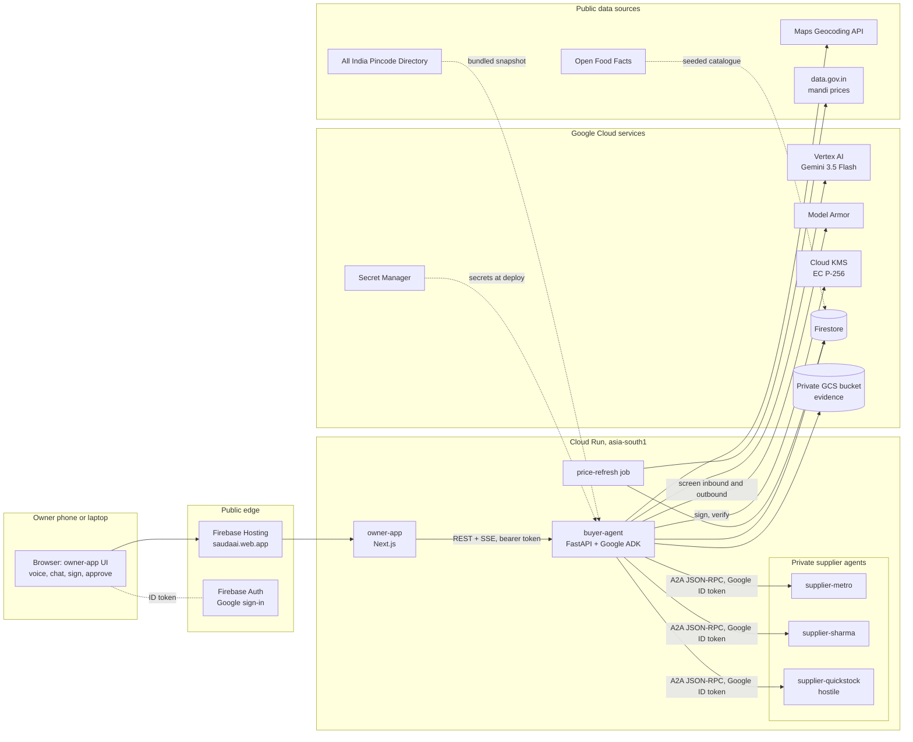
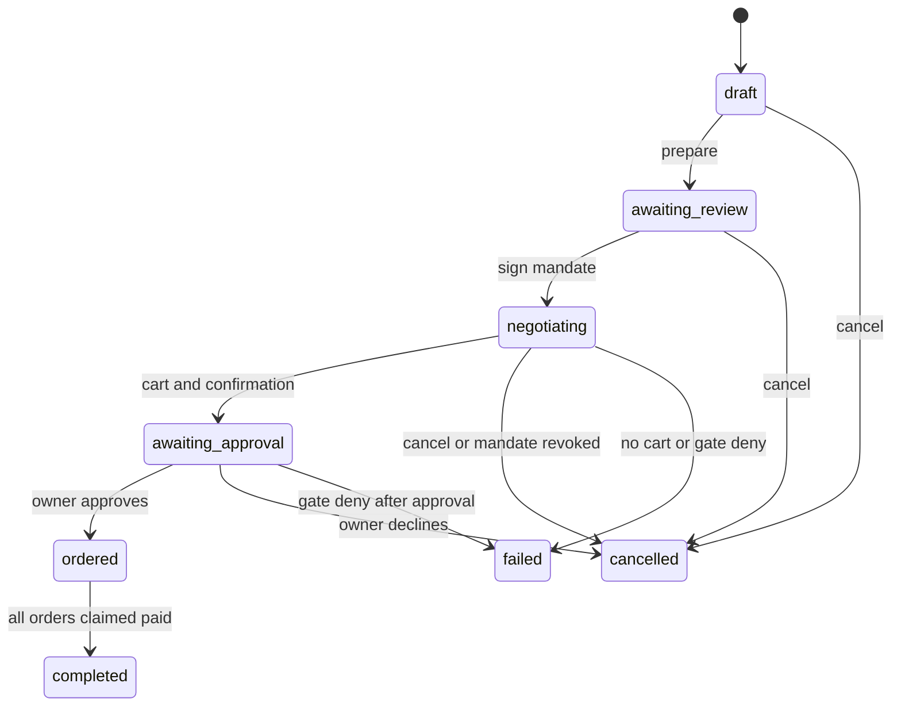
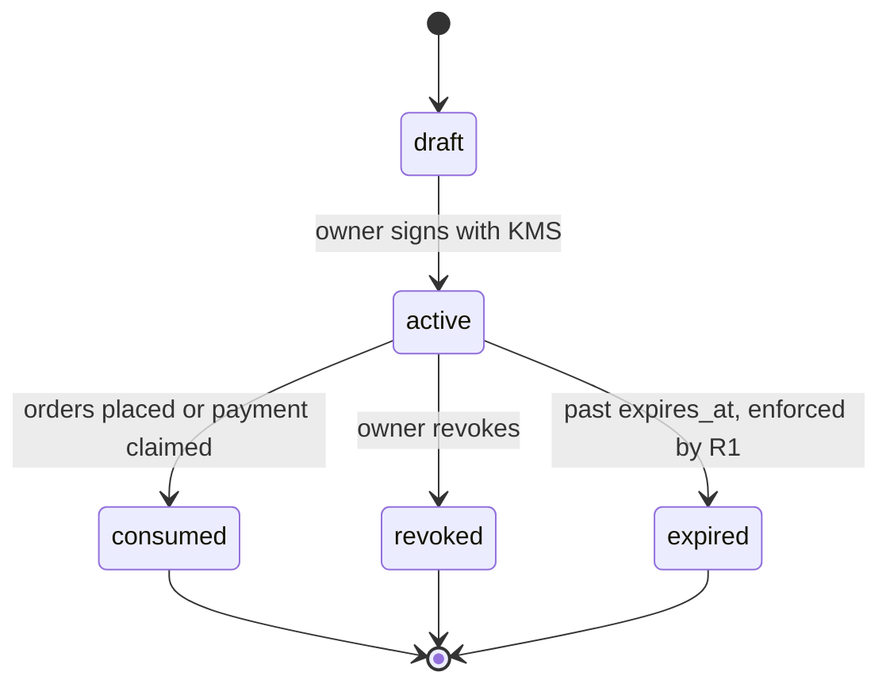
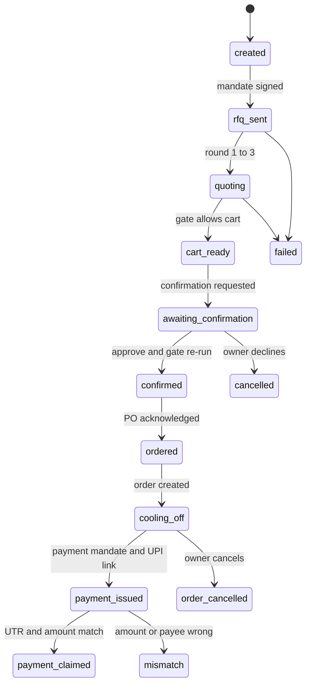
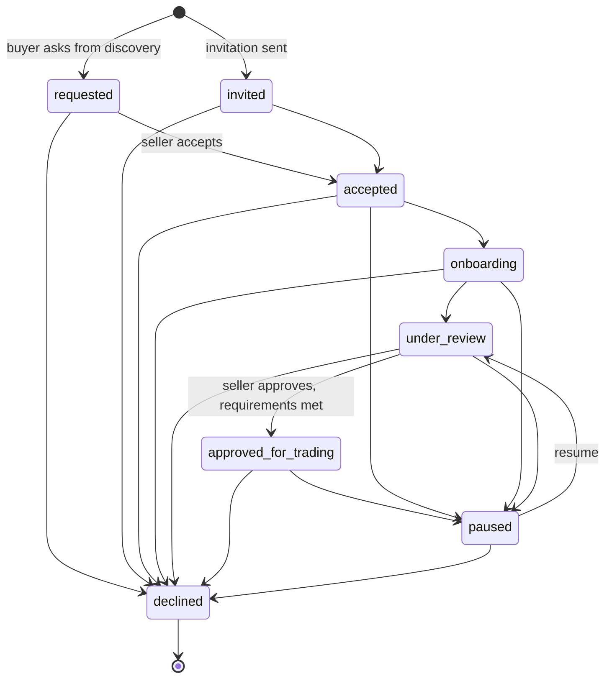
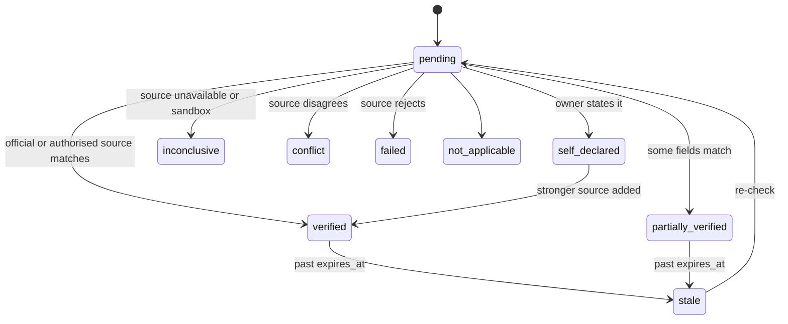
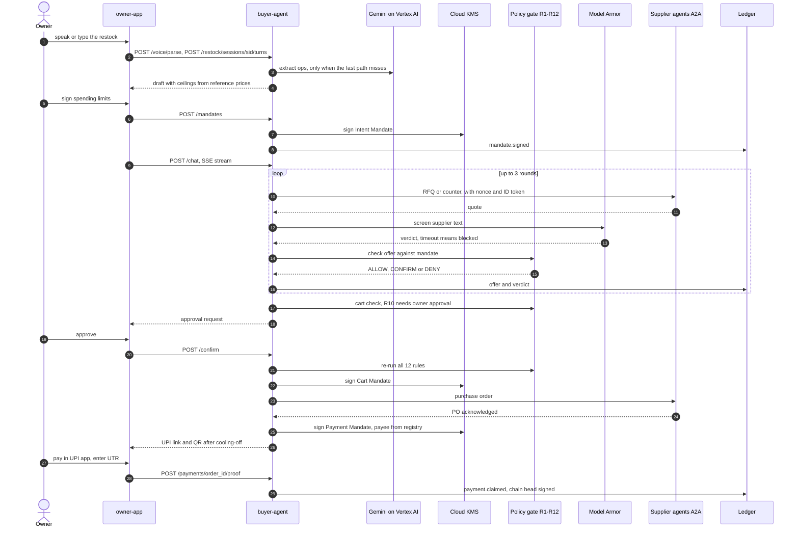

# SAUDA

**Restock within your limits.**

Sauda is a buyer agent for India's neighbourhood kirana stores. The owner says, in their own language, what the shop needs. Sauda turns that into a draft order, and the owner signs spending limits once: a budget, price ceilings, an advance-payment cap, approved suppliers and an expiry. Sauda then negotiates with supplier agents over the A2A protocol. It cannot spend a rupee outside those signed limits. Before money moves, the owner approves the final cart. Every step is written to a hash-chained, signed record that anyone can check.

Around that buyer agent sits the bigger goal: the **Trust Network**. It helps tier-2 and tier-3 shops go digital, prove who they are and trade only with partners whose identity has been checked. Each check is recorded separately, with its source shown.

Google Cloud AI Builder Cup 2026 · Theme: Retail & Commerce · Team **Inertia**

| | |
|---|---|
| Live app | https://saudaai.web.app |
| Demo video | `VIDEO_LINK_TBD` |
| Pitch deck | `DECK_LINK_TBD` |
| Deeper architecture | [docs/ARCHITECTURE.md](docs/ARCHITECTURE.md) |

---

## Contents

1. [The problem](#the-problem)
2. [What Sauda does](#what-sauda-does)
3. [Try it in 5 minutes](#try-it-in-5-minutes-judge-guide)
4. [Architecture (HLD)](#architecture-hld)
5. [Design principles](#design-principles)
6. [Architecture decision records](#architecture-decision-records)
7. [Low-level design](#low-level-design-lld)
8. [State machines](#state-machines)
9. [Core flow sequence](#core-flow-sequence)
10. [Security model](#security-model)
11. [Reliability and scalability](#reliability-and-scalability)
12. [Cost](#cost)
13. [Quality](#quality)
14. [Responsible AI and honesty](#responsible-ai-and-honesty)
15. [Accessibility and inclusion](#accessibility-and-inclusion)
16. [Roadmap](#roadmap)
17. [Repository, local development and deployment](#repository-layout)
18. [Team and licence](#team)

---

## The problem

- **Kirana stores are most of Indian retail.** India has an estimated 12 to 20 million kirana stores. They handle just over 90% of FMCG sales and contribute about 10% of GDP (CB Insights). The pattern repeats across Asia: Indonesia has 3.5 million warungs (KrASIA), and sari-sari stores drive 65% of cash transactions in the Philippines, where manufacturers and distributors do not serve them directly (Wavemaker).
- **Restocking is still done by phone.** Owners restock through calls and WhatsApp with 4 to 6 distributors. Prices are not transparent, and shelves run empty before festivals.
- **Distributors cannot be checked.** There is no easy way to confirm that a "distributor" is a real, registered business, so advance-payment fraud by fake distributors keeps growing.
- **Agentic commerce is skipping them.** Google's Universal Commerce Protocol (Jan 2026) lets merchants expose catalogues and checkout to agents (Converge Digest), and Gartner expects 90% of B2B transactions to be agent-intermediated by 2028 (Stellagent). This is being built for consumers and large enterprises. Small retailers get no buyer agent. No shopkeeper would trust one with their money unless its authority were provably bounded.

---

## What Sauda does

| Capability | What the owner sees | Where it lives |
|---|---|---|
| **Voice and typed restock in 13 languages** | Speak or type "10 Aashirvaad atta, 20 Tata salt, keep it under 8000". The draft updates live, and short edits like "make salt 25" come back in about 0.3 s. | `services/sessions.py`, `services/voice.py`, `voice_routes.py`, `lib/languages.ts` |
| **Conversational onboarding** | A guided chat, typed or spoken, builds the business profile: name, constitution, GST, PIN, products and consent. Aadhaar numbers are refused. | `onboarding_agent.py`, `onboarding_i18n.py`, `/network/onboard/voice` |
| **Business verification by dimension** | Separate statuses for identity, registration, address, representative, product compliance and more. Each check shows a **source badge**: official registry, authorised provider, uploaded evidence, human review, self-declared or simulated. | `packages/sauda_verify` |
| **Find verified suppliers** | Search opt-in seller listings by district, state or all of India, then send a guarded "request to connect". | `trust_network_discovery.py`, `/network/discover` |
| **Buyer/seller role switch, invitations, WhatsApp share** | One business can buy, sell or do both. Owners invite partners with a link they can share on WhatsApp. The relationship then moves through review to "approved for trading". | `trust_network_routes.py`, `components/network/*` |
| **Signed spending limits** | The owner signs an Intent Mandate once: budget, per-item price ceilings, maximum advance, suppliers, delivery date and expiry (7 days at most). It is signed with Cloud KMS (EC P-256). | `packages/sauda_trust/mandates.py`, `kms.py` |
| **A2A negotiation with three supplier agents** | Metro, Sharma and QuickStock quote over A2A. QuickStock is **hostile**: it tries prompt injection, a payee switch and an excessive advance. The negotiation runs for at most 3 rounds on a fixed concession schedule. | `negotiation/loop.py`, `negotiation/a2a.py`, `apps/supplier-agent`, `suppliers/*.json` |
| **Model Armor plus 12 deterministic rules** | Every supplier message is screened by Model Armor and regex rules. Every offer and action passes policy rules R1 to R12, and any error is a deny. | `sauda_trust/guard.py`, `sauda_trust/policy_gate.py`, `tool_broker.py` |
| **Approval, then UPI** | One approval screen. Then a 10-minute cooling-off period, a purchase order and a UPI deep link and QR for the payee from the registry. | `services/confirm.py`, `services/orders.py`, `/confirm`, `/pay` |
| **Hash-chained signed ledger** | Every plan, offer, verdict and decision is chained, KMS-signed and re-verifiable in the browser. A tamper demo is included. | `packages/sauda_ledger`, `/trust/[negotiationId]` |
| **10-attack security console** | Ten scripted attacks, from prompt injection to ledger tampering, each with the layer that stopped it. Judges can also type their own attack. | `services/attack.py`, `/attack` |
| **Sample shop and demo review console** | "Try with a sample shop" creates a personal simulated business in one tap. The demo reviewer console lets anyone act as the human reviewer on their own sample. | `trust_network_sandbox.py`, `/review` |

**Languages.** English, Hindi, Telugu, Tamil, Kannada, Malayalam, Marathi, Bengali, Gujarati, Punjabi, Odia, Urdu, plus **Bhojpuri in beta**. Bhojpuri has no browser speech locale, so the app listens to it as Hindi. On 18 Oct 2026, typed restock and onboarding passed in every one of the 13 languages against Vertex Gemini. Gemini audio transcription passed with synthetic voices for English, Hindi, Telugu, Tamil and Kannada. Bengali passed with caveats. Malayalam, Marathi, Gujarati, Punjabi, Odia and Urdu had no test voice, so their audio path is untested. Browser speech recognition for the new languages still needs a real-microphone test. The full table is in [docs/VOICE_CONVERSATION.md](docs/VOICE_CONVERSATION.md#languages).

---

## Try it in 5 minutes (judge guide)

Open **https://saudaai.web.app** on a phone or laptop.

| Step | Do this | What to look for |
|---|---|---|
| 1 | **Sign in with Google** | Any Google account works. Firebase Auth issues an ID token, and the buyer agent verifies it on every request. |
| 2 | Open **Network** and tap **Try with a sample shop** | You get your own "Sample Kirana" (simulated). It reads *Partially verified (sample)*, and each check carries a source badge. |
| 3 | **Find suppliers** | Search by area and send a request to connect to a demo supplier. Sample shops never appear in other people's search results. |
| 4 | **Restock**: speak or type an order | Pick your language. Try "10 atta, 20 Tata salt, 12 sunflower oil, keep under 8000", then "make salt 25". |
| 5 | **Sign limits** | Review the budget, ceilings and maximum advance, then sign. The mandate is signed with Cloud KMS. |
| 6 | **Watch the negotiation** | Three suppliers quote over A2A. QuickStock's injection, payee switch and advance demand are blocked live, and QuickStock is quarantined. |
| 7 | **Approve** | One approval for the final cart. The gate re-runs all 12 rules after you approve. |
| 8 | **Pay** | A UPI link and QR for the registered payee, capped at a ₹1 test payment. |
| 9 | **Trust record** | The hash chain is re-verified in your browser. Try the tamper demo and see the first broken entry flagged. |
| 10 | **Security tests** | Run all 10 attack scenarios, or type your own. |

**Nothing blocks you.** There are no documents to upload, no GST number to type and no real supplier to wait for. Sauda uses progressive trust: you can act straight away and add proof later.

**What is simulated, and labelled on screen:**
- The three supplier agents are demo distributors with real catalogues. Their strategies are published in [`suppliers/`](suppliers/).
- Sample shops and their checks are simulated (`simulated_fixture`). A demo-reviewer decision is labelled "not a real verification".
- Payment is a real UPI link, capped at ₹1 for testing. The UPI reference (UTR) you enter is recorded as **claimed, not bank-verified**. Sauda never holds funds.
- A supplier's VPA comes from the registry and is shown masked. It is a claimed payee, not one a bank has confirmed.
- Festival uplift is a suggestion you can apply, not your sales history.

---

## Architecture (HLD)



| Component | Responsibility |
|---|---|
| **Firebase Hosting** | The public front door. It rewrites every path to the owner-app Cloud Run service and hosts the Google sign-in handler, so the account chooser shows the product domain. |
| **owner-app** (Next.js, Cloud Run) | Owner and judge UI: restock, voice, mandate signing, approval, payment, Trust Network, review console, trust record and security console. It holds no secrets and talks only to the buyer agent. |
| **buyer-agent** (FastAPI + Google ADK) | The only service with authority. It hosts the ADK agent (Gemini on Vertex AI), the tool broker and policy gate, mandates, negotiation, orders, payments, ledger, Trust Network and verification. |
| **Supplier agents** (A2A) | Three private Cloud Run services built from one image (`SUPPLIER_PROFILE=metro\|sharma\|quickstock`). Only the buyer agent's service account can invoke them. |
| **Vertex AI Gemini** | Parses requests and voice, phrases replies, runs onboarding conversations and reads documents. It never sets a committed price, a payee or an approval. |
| **Model Armor** | Screens supplier messages, uploaded document text and outbound text for prompt injection and jailbreaks. Regex rules back it up. A timeout counts as blocked. |
| **Cloud KMS** | Signs mandates and ledger entries with EC P-256. The public key is served at `/pubkey`. |
| **Firestore** | All state. Client access is denied by `firestore.rules`, so every read and write goes through the buyer agent. |
| **Secret Manager** | data.gov.in key, Maps key, demo operator token and the demo payee VPA. Nothing secret is baked into images. |
| **Data sources** | Open Food Facts (product set), data.gov.in daily mandi prices (reference prices), the All India Pincode Directory (PIN, state and district checks) and Google Maps Geocoding (address location check). |

**Trust boundaries.**
1. **Browser to buyer agent.** Every owner route needs a Firebase ID token, which is verified on the server. Judge routes such as `/verify` and `/attack` are read-only and bound to demo data.
2. **Buyer agent to suppliers.** Supplier output is **untrusted data**. It is screened by Model Armor, parsed by code into typed quotes and gated by R1–R12. The model sees it only as labelled untrusted content.
3. **Model to money.** Gemini proposes; code decides. Prices, totals, payees and approvals are computed and checked deterministically.
4. **Service to data.** Each service runs as its own service account. Firestore has no client access. Evidence files live in a private bucket, and only members and reviewers get a 10-minute signed link.

The deeper design is in [docs/ARCHITECTURE.md](docs/ARCHITECTURE.md).

---

## Design principles

| # | Principle | Why | Where in code |
|---|---|---|---|
| 1 | **The model proposes; code decides money** | LLM output is probabilistic and can be injected. Money must be exact. | `negotiation/loop.py` (fixed concession schedule), `services/sessions.py` `apply_ops` (code builds every number and reply), SAUDA-014 (no Gemini price extraction) |
| 2 | **Fail closed** | An outage must never become permission. | `policy_gate.py`: any exception is `DENY GATE_ERROR`. `guard.py`: a timeout means blocked. KMS errors stop signing. |
| 3 | **Least authority through signed mandates** | The agent's power is exactly what the owner signed, and nothing more. | `sauda_trust/mandates.py` (`validate_intent`: catalogue, ceilings, expiry of 7 days at most, autonomy tier forced to 2) |
| 4 | **Honesty over polish** | Judges and owners must know what is real. | Labels in `DESIGN_SYSTEM.md` §4 "Honesty labels (must survive any restyle)". Payments are `claimed`, never "settled". Sandbox data is capped at `inconclusive`. |
| 5 | **Verification by dimension, no trust score** | One number hides why a business is or is not trusted. | `sauda_verify/models.py` `Dim`, `CheckStatus`, `SourceKind`. `policy.py` rolls up each dimension. |
| 6 | **Human review for credit and large orders** | Some decisions are too costly to automate. | `policy.py` `high_value_relationship` routing. R10 `OWNER_APPROVAL` on every order. |
| 7 | **Idempotency everywhere** | Phones retry, and networks drop. | R11 `DUPLICATE`, create-only order ids, a transaction on `confirmations`, `client_turn_id` on voice turns, idempotent `/tn/sandbox/start` |
| 8 | **Append-only signed records** | Evidence must survive disputes and tampering. | `sauda_ledger` (hash chain, v2 full-event signatures, KMS-signed chain head). Ledger entries are kept even when a sample shop is deleted. |
| 9 | **Privacy by redaction and masking** | Kirana owners' data is personal data. | VPAs and contacts are masked and HMAC'd, Aadhaar is never stored, no audio is stored, logs contain no transcript text (`TRUST_NETWORK.md` "Privacy and retention") |
| 10 | **Never blocked: progressive trust** | A first-time user must be able to act. | Sample shop, read-only discovery without a profile, self-declared checks shown as such |
| 11 | **Low cost, scale to zero** | A kirana product must run on cents. | Cloud Run `--min-instances 0` for owner-app and suppliers, a shared Python image, a 300 s catalogue cache and 1800 s price cache |

---

## Architecture decision records

| Decision | Alternatives considered | Why this one |
|---|---|---|
| A deterministic policy gate (R1–R12) is the only path to side effects | Ask the LLM to "follow the budget"; guardrails only | Guards are probabilistic. The gate is the guarantee and can be unit-tested. |
| KMS-signed AP2-style mandates (intent, cart, payment) | Session flags; a database row with limits | The signature makes the limits verifiable by anyone, with `/pubkey` public. |
| A2A between buyer and suppliers | Bespoke REST; scraping WhatsApp | It is an open protocol, so any A2A- or UCP-compatible supplier can plug in. |
| Gemini audio for transcription, with browser Web Speech as the live path | Cloud Speech-to-Text only | Code-mixed Indic speech and brand names. The rationale is in `VOICE_AGENT_DESIGN.md`. |
| A fast path for simple edits, with the model only when needed | The model on every turn | Edits take about 0.3 s instead of 1.6–3.3 s (`VOICE_CONVERSATION.md`). |
| Hash-chained ledger in Firestore with KMS signatures | A blockchain; plain logs | Tamper evidence without new infrastructure; it can be re-verified in the browser. |
| Separate verification dimensions with source kinds | A single trust score | Explainable, and one strong source cannot hide a missing one. |
| Firestore with no client access | Client SDK with rules | One audited writer, and simpler rules. |
| Cloud Run plus Firebase Hosting | GKE; App Engine | Scales to zero, gives each service its own identity and a clean custom domain. |
| UPI deep link, with the owner entering the UTR | A PSP integration | Hackathon scope. It is labelled "claimed, not bank-verified", and PSP or AP2 settlement is on the roadmap. |

---

## Low-level design (LLD)

| Module | Owns |
|---|---|
| `packages/sauda_trust` | `mandates.py` (intent, cart and payment mandates; validation; status), `kms.py` (signer), `policy_gate.py` (R1–R12), `tool_broker.py` (every tool call goes through the gate), `guard.py` (Model Armor, regex, timeout), `registry.py` (supplier allowlist, card fingerprints, payout VPA) |
| `packages/sauda_ledger` | `events.py` (append, chain head), `verify.py` (payload hash, links, signatures, first broken seq) |
| `packages/sauda_data` | `products.py` (Open Food Facts), `price_refs.py` and `refresh.py` (data.gov.in mandi prices), `calendar.py` (festivals), `purchases.py` |
| `packages/sauda_verify` | `models.py` (Business, Check, enums), `policy.py` (pure rules: dimension rollup, category, review reasons, readiness), `store.py` (`tn_*` collections, compare-and-set writes), `providers/` (GSTIN checksum, GST registry via Cashfree or Setu in sandbox, MCA, Udyam, FSSAI, PIN directory, geocode, documents, photo, bank, contact, simulated) |
| `apps/buyer-agent/buyer_agent` | `main.py` (core routes), `agent/` (ADK root agent, tools, prompts), `negotiation/` (A2A client, loop, cart), `services/` (chat SSE, confirm, orders, sessions, demand, voice, attack, metrics), `trust_network_*.py` (Trust Network, discovery, sandbox), `onboarding_*.py`, `voice_routes.py`, `session_routes.py`, `deps.py` (settings, auth) |
| `apps/supplier-agent` | The A2A server, `quote_engine.py` and profiles. The strategies are in `suppliers/*.json`. |
| `apps/owner-app` | Next.js App Router pages in `app/` (`restock`, `mandate`, `confirm`, `pay`, `orders`, `trust`, `attack`, `savings`, `network/*`, `review`, `invite`), components in `components/` (`restock`, `voice`, `network`, `TrustConsole`, `AttackBox`), and `lib/` (API client, auth, chain verify, languages, latency) |

### Main API endpoints (buyer-agent)

| Group | Endpoints |
|---|---|
| Health and keys | `GET /health`, `GET /pubkey` |
| Catalogue and shop | `GET /products`, `GET /shops/{id}/overview`, `POST /shops/{id}/kill-switch` |
| Restock sessions | `POST/GET /restock/sessions`, `GET/PATCH /restock/sessions/{sid}`, `POST .../turns`, `POST .../prepare`, `POST .../cancel` |
| Voice | `POST /voice/parse`, `POST /telemetry/voice` |
| Mandates | `POST /mandates`, `GET /mandates/{id}`, `POST /mandates/{id}/revoke` |
| Negotiation | `POST /chat` (SSE), `GET /negotiations/{nid}`, `GET /events` |
| Approval | `GET /confirm/{id}`, `POST /confirm` |
| Orders and payment | `GET /orders/{id}`, `POST /orders/{id}/cancel`, `POST /payments/{order_id}/proof` |
| Trust record | `GET /verify/{negotiation_id}`, `POST /verify`, `GET /metrics/{shop_id}` |
| Security console | `GET /attack/scenarios`, `POST /attack/scenarios/{id}`, `POST /attack` |
| Trust Network | `/tn/businesses` (create, mine, profile, summary, checks, evidence, ledger, location, verify, listing, contact verify, request review), `/tn/discover`, `/tn/areas`, `/tn/connect`, `/tn/invitations`, `/tn/relationships`, `/tn/onboarding`, `/tn/sandbox` |
| Review | `GET /review/me`, `GET /review/queue`, `GET /review/tasks/{tid}`, `POST /review/tasks/{tid}/decision` |

### Firestore collections

| Collection | Holds |
|---|---|
| `products`, `price_refs`, `price_refs_meta`, `calendar` | Catalogue (GTIN, pack, MRP), mandi reference prices with source and date, festival dates |
| `shops` | Shop overview, kill switch, `active_negotiation_id` lock |
| `restock_sessions` | Draft lines, budget, transcript turns (capped), version for compare-and-set |
| `mandates` | Signed intent, cart and payment mandates with status |
| `negotiations`, `offers` | Negotiation status, rounds, suppliers, quotes |
| `confirmations` | Approval requests and their transactional status |
| `orders` | Lines, totals, cooling-off, PO acknowledgement, payment status, UTR claim |
| `suppliers` | Registry: allowlist status, agent-card fingerprint, payout VPA |
| `ledger_events`, `ledger_heads` | Hash-chained signed events per chain, signed chain head |
| `tn_businesses`, `tn_checks`, `tn_cases`, `tn_evidence`, `tn_reviews`, `tn_relationships`, `tn_invitations`, `tn_onboarding` | Trust Network: businesses, per-dimension checks, review cases, evidence metadata, reviews, relationships, invitations, onboarding conversations |

---

## State machines

### Restock session (`services/sessions.py`, derived from the negotiation and orders)



Edits are allowed only in `draft` and `awaiting_review`. In any other state they return 409 `session_locked`.

### Mandate (`sauda_trust/mandates.py`)



### Negotiation, confirmation and payment



A confirmation moves `requested → approving → approved | denied | error` inside a Firestore transaction. It can also end `declined`, `expired`, `stale` or `superseded`. No payment mandate is issued unless the supplier acknowledged the PO.

### Relationship (`trust_network_routes.py` `TRANSITIONS`)



Only the seller can approve. Approval also fails with 409 `human_review_required` or `requirements_not_met` when the buyer's checks do not meet the requested tier.

### Verification check status (`sauda_verify/models.py` `CheckStatus`)



A provider outage becomes `inconclusive` with `available: false`. It is not counted as a finding about the business.

---

## Core flow sequence



---

## Security model

The design follows the OWASP Top 10 for Agentic Applications (2026) and Google's three principles for secure agents: well-defined human controllers, carefully limited powers and observable actions. The full review is in [docs/SECURITY_REVIEW.md](docs/SECURITY_REVIEW.md), and issue status is in [docs/ISSUE_REGISTER.md](docs/ISSUE_REGISTER.md).

| Threat | Control | Where |
|---|---|---|
| Prompt injection from a supplier or a document | Model Armor plus regex. Supplier text is treated only as labelled untrusted data. R9 denies any offer with a blocked verdict, and a second block quarantines the supplier. Even unscreened, R3 and R4 bound the numbers. | `guard.py`, `policy_gate.py`, `negotiation/loop.py` |
| Payee switch ("our UPI has changed") | R8 `PAYEE_MISMATCH`. The payment mandate payee always comes from the registry and never from model or supplier text. | `policy_gate.py`, `services/orders.py` |
| Advance-payment fraud | R5 `ADVANCE_TOO_HIGH` against the signed maximum, with finite-number checks. The regex guard catches advance demands. | `policy_gate.py` |
| Over-budget or bait pricing | R3 `OVER_BUDGET`, R4 `OVER_CEILING` and `INVALID_AMOUNT`. Code totals the cart. | `policy_gate.py`, `negotiation/cart.py` |
| Ledger tampering | Payload hash, chain links, KMS signatures over the full event (v2) and a signed chain head. An empty or truncated chain fails. | `sauda_ledger/verify.py` |
| Replay or double order | R11 `DUPLICATE`, create-only order ids, a transactional confirmation and per-message A2A nonces | `policy_gate.py`, `services/confirm.py`, `a2a.py` |
| Unknown or spoofed supplier | R2 `SUPPLIER_UNKNOWN`: allowlist, registry status and agent-card fingerprint. Suppliers are private Cloud Run services. | `policy_gate.py`, `registry.py`, `deploy/cloudrun.sh` |
| Duplicate or impersonated businesses | GSTIN checksum, registry and PIN cross-checks. Evidence is deduplicated by SHA-256, and a file reused by another business is flagged for review. Contacts are verified by one-time code. | `sauda_verify/providers`, `TRUST_NETWORK.md` |
| Unauthorised approval | Firebase ID token on every owner route. Tool ids are checked against the session's shop and owner. Only the seller approves a relationship. Reviewer actions on real businesses are limited to configured reviewers. | `deps.py`, `agent/tools.py`, `trust_network_routes.py` |
| Expired or revoked authority | R1 `MANDATE_INVALID` and R12 `REVOKED` (kill switch), checked every round and after confirmation | `policy_gate.py` |
| PII exposure | VPAs and contacts are masked and HMAC'd. Aadhaar is refused and never stored. No audio and no OTPs are stored. Ledger payloads are masked before hashing, and client errors carry no exception text. | `TRUST_NETWORK.md`, `VOICE_AGENT_DESIGN.md`, SAUDA-016/020 |
| Guard timeout or outage | Fails closed: `blocked=True, source="timeout"`, and R9 denies. Outbound screening also fails closed (SAUDA-015). | `guard.py` |
| Abuse of the public attack box | Rate limit on the last X-Forwarded-For hop, a global cap and truncated stored text | `main.py`, SAUDA-012 |

**Authentication and authorisation.** Owners sign in with Google through Firebase Auth, and the buyer agent verifies the ID token on every owner request. Records are bound to the owner. A per-shop lock allows one active negotiation at a time (409 otherwise). Trust Network members see only their own businesses, and counterparties never get documents.

**Secrets.** Secrets live in Secret Manager and are mounted at deploy time. Each service has its own service account, and there are no key files on disk. The Firebase web config is public by design, and no owner token is baked into the bundle.

**Data retention.** No audio is stored. Session turns are capped at 200 and turn text at 1,000 characters. Evidence rows carry `retention_until` (365 days), but deletion is not automated yet. A Firestore TTL on restock sessions is an open item. Ledger entries are append-only by design.

**Known open items, stated honestly** (from the issue register):
- the "owner-signed" mandate is signed by the server's KMS key, and owner-held keys are on the roadmap (SAUDA-027);
- the buyer service account can write the payee registry (SAUDA-026);
- money paths still use some floats (SAUDA-017);
- R7 is inert at commit (SAUDA-018).

---

## Reliability and scalability

| Aspect | Today | Source |
|---|---|---|
| Compute | Cloud Run in asia-south1. buyer-agent runs with 1 vCPU and 1 GiB, `min=1 max=1` and a 600 s timeout. owner-app runs `min=0 max=3`, and the suppliers run `min=0 max=2`. | `deploy/cloudrun.sh` |
| Idempotency | R11, create-only order ids, a transactional confirmation (3 concurrent approves produced 1 order in a live test), `client_turn_id` retries and versioned compare-and-set saves for sessions and Trust Network records | `ISSUE_REGISTER.md` SAUDA-007, `SESSION_PERSISTENCE.md` |
| Retries | A2A uses a 20 s timeout with 1 retry that reuses the nonce. The price-refresh job retries twice. Voice Retry re-uploads the in-memory recording. | `a2a.py`, `cloudrun.sh`, `VOICE_AGENT_DESIGN.md` |
| Vertex quota (429) | During testing, Vertex returned `429 RESOURCE_EXHAUSTED` on the shared project quota. Those calls were retried, and the user sees a plain "could not transcribe right now" or "wait" message. The voice route also limits each owner to 12 requests a minute. | `VOICE_CONVERSATION.md`, `VOICE_AGENT_DESIGN.md` |
| Measured latency | Fast-path edits: 0.31–0.37 s client round trip. Model turns: 1.6–3.3 s. Recorder voice: about 6.6–7.3 s from end of speech to updated draft. `/verify`: 0.18 s live. All laptop measurements on 18 Oct 2026. | `VOICE_CONVERSATION.md`, `PRODUCT_AUDIT.md` |
| Negotiation | A cold negotiation after idle can exceed 60 s, because the suppliers scale to zero. The target is 30 s or less. | `ROADMAP.md`, SAUDA-022 |

**At 10× load.** Lift the buyer agent's `max=1`. That needs the ADK negotiation sessions, which are still in memory (SAUDA-021), moved to Firestore; restock sessions are already persisted. Keep the suppliers warm with `min=1` during peaks. Cache `/metrics`, which currently reads every ledger (SAUDA-025). Request a higher Vertex quota.

**At 1000× load.** The architecture is unchanged, but several pieces have to be rebuilt:
- shard the ledger heads and anchor batches of signatures, because every append is a KMS call today;
- run real suppliers as their own A2A endpoints instead of three simulated ones;
- use a regional Model Armor endpoint (it is us-central1 today);
- replace the per-shop lock with per-user negotiations;
- adopt PSP-confirmed settlement;
- set SLOs, add correlation ids (SAUDA-024) and add structured alerting on `source=timeout`.

---

## Cost

The repository has no measured cost figures, so this section is qualitative. Owner-app and supplier services scale to zero. The buyer agent keeps one warm instance. Simple restock edits are handled by deterministic code with no model call. The catalogue and reference prices are cached. The main variable costs are Gemini calls, Model Armor screens and KMS signatures, which run roughly one per ledger event.

---

## Quality

- **499 automated tests pass** (`uv run pytest -q`, 499 passed, run at the time of writing). They cover:
  - every policy gate rule and the extra gate checks;
  - mandate signing and validation, ledger v2 and the chain head;
  - API authentication and shop isolation, confirm concurrency, payments and payee masking;
  - restock sessions, the demand draft, voice parsing and languages;
  - negotiation quotes, attack scenarios and routes, regressions and price refresh;
  - the onboarding agent, verification providers (GSTIN, PIN, GST adapters, matching, registry), the verify policy, discovery, the sandbox, roles and contact checks.
- **End-to-end checks** recorded in the docs:
  - 10/10 attack scenarios verified live (ISSUE_REGISTER SAUDA-030);
  - live `/verify` returns `chain_ok=true` (PRODUCT_AUDIT §12);
  - 13-language typed restock and onboarding against real Vertex Gemini (VOICE_CONVERSATION);
  - voice latency scripts in headless Chrome;
  - a concurrency test: 3 concurrent approves produced 1 order.
- The test strategy and the regression list are in [docs/TEST_PLAN.md](docs/TEST_PLAN.md). Frontend and accessibility automation is still partial.

---

## Responsible AI and honesty

| Real | Simulated, and labelled |
|---|---|
| Product set (Open Food Facts), government mandi reference prices with source and date, KMS keys, Model Armor screening, the ledger, Cloud Run deployment, Firebase sign-in, the GSTIN checksum, PIN directory checks and geocoding | The three supplier agents and their strategies |
| A real UPI link to the registered payee | Payment capped at ₹1 for testing. The UTR is **claimed, not bank-verified**. |
| Trust Network policy and the review workflow | Sample shops, demo fixtures and demo-reviewer decisions. GST provider calls run in sandbox and are capped at `inconclusive`. |
| | The savings baseline is the suppliers' opening quotes, and festival uplift is a stated assumption |

**Model limits.**
- Model Armor is probabilistic. It is never the only control, because the gate is the guarantee.
- Voice was tested with synthetic voices, not real shopkeepers in noisy shops.
- Bhojpuri is understood through Hindi recognition.
- Restock confirmations are in the owner's language; a few onboarding read-back values (for example "not GST registered") are still English inside a sentence in the owner's language.
- Gemini never writes a committed number or the reply text for restock edits.

**Fairness.** Missing documents lead to "self-declared" or "pending", never to a penalty score. A provider outage is never held against a business.

---

## Accessibility and inclusion

- **Language and input.** Sauda supports 13 languages with native script names in the picker. Indic digits are normalised. Owners can speak or type.
- **Low literacy.** Each step asks for one action, uses plain words and reads what was understood back in the owner's language. Voice works for both restock and onboarding.
- **Design system: "Ledger".** It is documented in [docs/DESIGN_SYSTEM.md](docs/DESIGN_SYSTEM.md).
  - Contrast: slate text at 17.8:1, 7.6:1 and 4.8:1 on white.
  - Every screen has loading, empty, error-with-retry, disabled and success states.
  - Assistive technology: a skip link, `aria-current` and `aria-live` regions.
  - Layout: it holds at 360 px.
- **Honesty labels are part of the design system.** They are required to survive any restyle.

---

## Roadmap

From [docs/ROADMAP.md](docs/ROADMAP.md), plus the next Trust Network steps:

- **Onboarding and identity:**
  - WhatsApp Business onboarding and ordering;
  - an authorised GST API in production (Cashfree or Setu adapters exist and run in sandbox today);
  - DigiLocker-based document verification;
  - owner-held keys or passkey co-signature for mandates (SAUDA-027).
- **Trading:**
  - real distributors onboarding over A2A, and ONDC;
  - real settlement through AP2 or a PSP, with webhook-confirmed status and refunds;
  - pooled buying across shops;
  - supplier credit terms in mandates;
  - bill and shelf photos for purchase history and stock estimates.
- **Platform:**
  - durable negotiation state, multiple negotiations per shop and cold start of 5 s or less;
  - external anchoring of the ledger and a payee registry in a separate trust domain;
  - consented FMCG demand insights and agent identity on Agent Engine.

---

## Repository layout

```
apps/owner-app/        Next.js owner app: restock, voice, mandate, confirm, pay, network, review, trust, attack
apps/buyer-agent/      FastAPI + Google ADK buyer agent, Trust Network routes, onboarding, voice
apps/supplier-agent/   A2A supplier agents (SUPPLIER_PROFILE=metro|sharma|quickstock)
packages/sauda_trust/  mandates (KMS), policy gate, tool broker, guard (Model Armor), registry
packages/sauda_ledger/ hash-chained, signed ledger and verify
packages/sauda_data/   Open Food Facts products, data.gov.in reference prices, festival calendar
packages/sauda_verify/ Trust Network models, verification policy, store, source providers
suppliers/             supplier profiles and published strategies
scripts/               fetch, seed, register suppliers, reset demo, provider check
deploy/                Dockerfiles, Cloud Build, cloudrun.sh, Firebase Hosting
docs/                  architecture, security, trust network, voice, design system, tests, roadmap
tests/                 Python test suite
```

## Local development

```bash
uv sync                                    # Python 3.12 workspace
cp .env.example .env                       # set GOOGLE_CLOUD_PROJECT=<project-id> and the data keys
uv run pytest -q                           # full test suite
uv run scripts/seed.py                     # products, reference prices, calendar into Firestore
for p in metro:8001 sharma:8002 quickstock:8003; do
  SUPPLIER_PROFILE=${p%%:*} PORT=${p##*:} uv run --package supplier-agent python -m supplier_agent.main &
done
uv run --package buyer-agent uvicorn buyer_agent.main:app --port 8080
cd apps/owner-app && pnpm install && pnpm dev
```

## Deployment

`deploy/cloudrun.sh <build-py|suppliers|buyer|owner|refresh|all>` reads `GOOGLE_CLOUD_PROJECT` from `.env` and deploys to `asia-south1`:

1. **build-py.** Cloud Build builds the shared Python image into Artifact Registry.
2. **suppliers.** It deploys three private supplier services, each with its own service account, and grants `run.invoker` only to the buyer agent's service account.
3. **buyer.** It deploys the buyer agent with KMS, Model Armor and Vertex settings. Secrets are mounted from Secret Manager.
4. **owner.** It builds and deploys the Next.js app, then releases Firebase Hosting, which purges the CDN cache.
5. **refresh.** It sets up a Cloud Run job and a Cloud Scheduler trigger for mandi prices at 11:00 and 19:00 IST. The schedule is paused for now, because data.gov.in returns 403 to cloud IPs (SAUDA-023).

---

## Team

**Inertia**, led by **N Chandra Sekhara**.

## License

All rights reserved. Third-party data keeps its own licence:
- Open Food Facts product data is under ODbL, and its images are under CC BY-SA.
- data.gov.in data is under the Government Open Data Licence – India.
