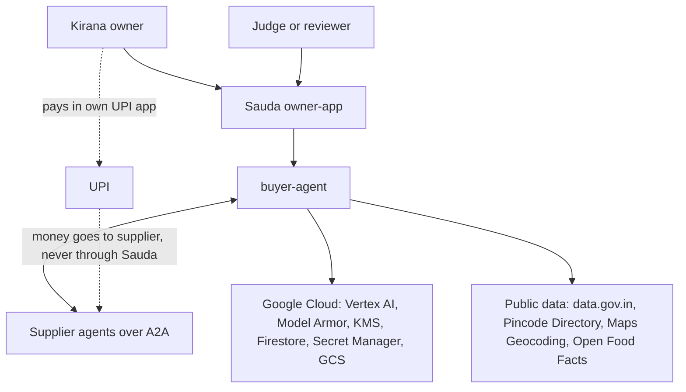
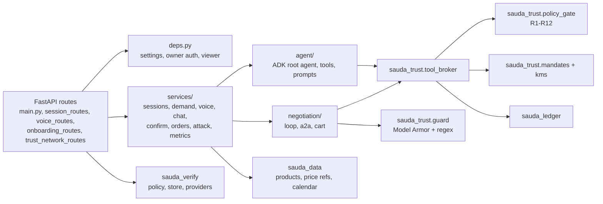
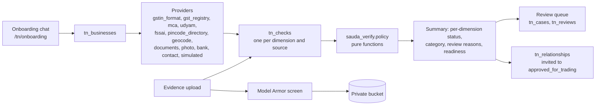

# Sauda: Architecture

This document describes Sauda's design in more depth than the [README](../README.md). It covers the system context, the services and their identities, the agent and trust layers, the Trust Network, the data model, the failure modes and the known limits. Every statement points to code or to another document in `docs/`.

Related documents:

| Document | Covers |
|---|---|
| [SECURITY_REVIEW.md](SECURITY_REVIEW.md) | Threat model, OWASP agentic mapping, the ten attack scenarios, authorisation review |
| [ISSUE_REGISTER.md](ISSUE_REGISTER.md) | Every known issue (SAUDA-001 to SAUDA-031) with its status |
| [PRODUCT_AUDIT.md](PRODUCT_AUDIT.md) | Route inventory, IAM, schemas, execution paths, baseline evidence |
| [TRUST_NETWORK.md](TRUST_NETWORK.md) | Trust Network data model, policy method, review, discovery, sample shop, privacy |
| [TRUST_NETWORK_UX.md](TRUST_NETWORK_UX.md) | Trust Network screens and states |
| [VERIFICATION_SOURCES.md](VERIFICATION_SOURCES.md) | Research on Indian verification sources and adapter decisions |
| [VOICE_AGENT_DESIGN.md](VOICE_AGENT_DESIGN.md) | Voice parse pipeline, audio validation, language evaluation |
| [VOICE_CONVERSATION.md](VOICE_CONVERSATION.md) | Continuous voice, 13 languages, measured latency |
| [SESSION_PERSISTENCE.md](SESSION_PERSISTENCE.md) | Restock session data model, lifecycle, concurrency |
| [TRUST_ATTACK_SAVINGS.md](TRUST_ATTACK_SAVINGS.md) | Trust record, security tests, savings, orders and pay screens |
| [DESIGN_SYSTEM.md](DESIGN_SYSTEM.md), [UX_REDESIGN.md](UX_REDESIGN.md) | The "Ledger" design system, the honesty labels and the UX decisions |
| [TEST_PLAN.md](TEST_PLAN.md) | Test layers, security, accessibility, end-to-end and performance plans |
| [ROADMAP.md](ROADMAP.md) | Prototype versus production, dependencies, future work and residual risk |

---

## 1. System context

Sauda never holds funds. It issues a UPI deep link and QR for the registered payee, and the owner pays from their own UPI app.

---

## 2. Services, identities and deployment

All services run on Cloud Run in `asia-south1` and are deployed by `deploy/cloudrun.sh`.

| Service | Image | Service account | Ingress | Scaling (from `cloudrun.sh`) |
|---|---|---|---|---|
| `owner-app` | `deploy/Dockerfile.owner-app` (Next.js) | `owner-app@<project-id>` | Public, behind Firebase Hosting | 1 vCPU, 512 MiB, min 0, max 3 |
| `buyer-agent` | `deploy/Dockerfile.python` (shared) | `buyer-agent@<project-id>` | Public; every owner route verifies a token | 1 vCPU, 1 GiB, min 1, max 1, 600 s timeout |
| `supplier-metro`, `supplier-sharma`, `supplier-quickstock` | shared Python image, `SUPPLIER_PROFILE` selects the profile | `supplier@<project-id>` | `--no-allow-unauthenticated`. Only the buyer agent's service account has `run.invoker`. | 1 vCPU, 512 MiB, min 0, max 2 |
| `price-refresh` (Cloud Run job) | shared Python image, `python -m sauda_data.refresh` | `price-refresh@<project-id>` | Cloud Scheduler, 11:00 and 19:00 IST | 600 s task timeout, 2 retries. Paused, because data.gov.in returns 403 to cloud IPs (SAUDA-023). |

**Firebase Hosting** (`firebase.json`) rewrites `**` to the `owner-app` service and hosts the Google sign-in handler on the product domain.

**Configuration** is set through environment variables. Only the names are listed here:
- `GOOGLE_CLOUD_PROJECT`, `GOOGLE_CLOUD_LOCATION`, `GOOGLE_GENAI_USE_VERTEXAI`, `GEMINI_MODEL` (`gemini-3.5-flash`);
- `KMS_KEY_NAME`, `MODEL_ARMOR_TEMPLATE` (a us-central1 template), `PRIVATE_BUCKET`, `SUPPLIER_URLS`, `OWNER_APP_ORIGIN`;
- `AUTH_MODE`, `AGENT_MODE` (`adk`), `DEMO_SHOP_ID`, `DEMO_PAY_AMOUNT_PAISE` (100, which is ₹1), `COOLING_OFF_MIN` (default 10);
- `REVIEWER_UIDS` and `REVIEWER_EMAILS`.

**Secrets** come from Secret Manager at deploy time: the data.gov.in key, the Maps Geocoding key, the demo operator token and the demo supplier payout VPA. The Firebase web configuration is public by design. No owner token is baked into the bundle when `AUTH_MODE=firebase`.

**Data access.** `firestore.rules` denies all client reads and writes. The buyer agent is the only writer. The supplier service account had its Firestore viewer role removed (SAUDA-013).

---

## 3. Buyer agent internals

### 3.1 The agent and the tools

- The ADK root agent (`agent/root.py`) runs Gemini on Vertex AI, using the model named in settings.
- Tools (`agent/tools.py`) are the only way the agent can act. Each one goes through `tool_broker`. The broker builds the gate context, runs the policy gate and writes the ledger. A broker context failure or a ledger failure is a DENY (`tool_broker.py`).
- Tool arguments that name a shop or negotiation are checked against the session's shop and owner. A mismatch returns `NOT_THIS_SESSION` (SAUDA-008).
- `place_order` is the only tool with side effects. It needs the owner's confirmation, and the gate runs again on resume.
- If the model skips a required tool, a deterministic fallback router in `services/chat.py` runs the same brokered tools. The client removes duplicate events.

### 3.2 Restock drafting: the fast path and the model path

The restock flow is described in `services/sessions.py` and [SESSION_PERSISTENCE.md](SESSION_PERSISTENCE.md).

1. A turn (`POST /restock/sessions/{sid}/turns`) carries a `client_turn_id`. A retry with the same id is removed as a duplicate.
2. A deterministic parser handles simple edits such as set quantity, remove, budget and total questions. These need no model call: the fast-path decision takes under 3 ms (VOICE_CONVERSATION.md).
3. Anything else goes to Gemini, which returns **typed ops** (`add_line`, `set_qty`, `remove`, `set_budget`, `replace_product`) with a confidence and an intent. Gemini never returns numbers that are committed, and it never writes the reply text.
4. `apply_ops` applies the ops in code. `demand.draft_line` and `finalize_draft` compute the ceilings, the estimate and the suggested mandate from catalogue MRPs and mandi reference prices. The catalogue is cached for 300 s and the reference prices for 1800 s.
5. The session is saved with a version check (compare-and-set). Edits are allowed only in `draft` and `awaiting_review`.

### 3.3 Voice

Voice is described in [VOICE_AGENT_DESIGN.md](VOICE_AGENT_DESIGN.md) and [VOICE_CONVERSATION.md](VOICE_CONVERSATION.md).

- **Primary path.** Browser Web Speech runs in continuous mode with interim results. Each final result becomes a turn.
- **Fallback path.** MediaRecorder records audio, and a voice-activity detector (900 ms of silence or 25 s per segment) splits it into segments. Each segment goes to `POST /voice/parse`.
- **Server checks on `/voice/parse`:**
  - 12 requests a minute per owner;
  - a 3 MB cap, with the body parsed in memory;
  - the container is sniffed from its magic bytes, the duration must be 60 s or less, and silence is detected before any model call;
  - Gemini then transcribes with a JSON schema at temperature 0.
- **Privacy.** No audio is stored. Logs never contain transcript text.

### 3.4 Negotiation

The negotiation is implemented in `negotiation/loop.py` and `negotiation/a2a.py`, with the state machine in PRODUCT_AUDIT §6.

- It contacts at most 3 suppliers and runs at most 3 rounds, on a deterministic concession schedule. A shop can have only one active negotiation at a time (`shops.active_negotiation_id`).
- The A2A client uses JSON-RPC with v0.3 compatibility. It sends a Google ID token, and only the buyer agent's identity can invoke a supplier. Each message carries a nonce, which the supplier must echo. The client fetches the agent card and checks its fingerprint against the registry (R2).
- Every inbound message is screened by the guard (Model Armor plus regex). After **2 guard blocks**, or a **missing nonce echo**, the supplier is quarantined.
- Quotes are parsed by code into typed `QuoteLine`s with bounds. Replies that cannot be parsed are logged as `offer.unparseable` and never interpreted by the model (SAUDA-014).
- The A2A timeout is 20 s, with 1 retry that reuses the nonce. Fetching the agent card times out after 10 s.

### 3.5 Policy gate (R1–R12)

`packages/sauda_trust/policy_gate.py` is deny-by-default. If any rule raises an exception, the result is `DENY GATE_ERROR`.

| Rule | Check | On failure |
|---|---|---|
| R1 | The mandate signature verifies, its status is active and it has not expired | DENY `MANDATE_INVALID` |
| R2 | The supplier is allowlisted and its agent-card fingerprint matches the registry | DENY `SUPPLIER_UNKNOWN` |
| R3 | The sum of allocated subtotals is within the budget | DENY `OVER_BUDGET` |
| R4 | Every unit price is within its line ceiling, and every amount is valid | DENY `OVER_CEILING` or `INVALID_AMOUNT` |
| R5 | `advance_pct` is finite and no more than `max_advance_pct` | DENY `ADVANCE_TOO_HIGH` |
| R6 | Delivery fits the deliver-by date | CONFIRM `LATE_DELIVERY` |
| R7 | Quantity is at most 1.5 × forecast, and price is at least 0.5 × reference | CONFIRM `ANOMALY` (inert at commit, SAUDA-018) |
| R8 | The payee VPA equals the supplier's registered payout VPA | DENY `PAYEE_MISMATCH` |
| R9 | The guard verdict for the message that produced the offer is clean. A missing verdict counts as blocked. | DENY `GUARD_BLOCKED` |
| R10 | `place_order` or payment below autonomy tier 3 needs owner approval. Tier is forced to 2. | CONFIRM `OWNER_APPROVAL` |
| R11 | The idempotency key has not been seen | DENY `DUPLICATE` |
| R12 | The kill switch is off and the mandate is not revoked | DENY `REVOKED` |

**Guard and gate.** The guard is probabilistic and the gate is deterministic, and the gate is the guarantee. A guard timeout or error returns `blocked=True, source="timeout"`, in both directions (SAUDA-015). The full comparison is in SECURITY_REVIEW §2.

### 3.6 Mandates

`packages/sauda_trust/mandates.py` follows the AP2 style: there are three kinds of mandate, `intent`, `cart` and `payment`.

- **Intent Mandate.** It holds the budget, the per-line ceilings, the approved suppliers, `max_advance_pct`, the deliver-by date and the expiry. `validate_intent` checks the lines against the catalogue, checks quantities and ceilings, limits expiry to 7 days and forces the autonomy tier to 2 (SAUDA-009).
- **Signing.** Mandates are signed by `KmsSigner` using EC P-256, with a 10 s timeout. If signing errors, it fails closed. The public key is at `GET /pubkey`.
- **Statuses.** A mandate is `draft`, `active`, `consumed`, `revoked` or `expired`. The owner revokes with `POST /mandates/{id}/revoke`, which also cancels any negotiation that is still running.
- **Cart Mandate.** It is signed after the owner approves and the gate allows the cart.
- **Payment Mandate.** It is issued only after the supplier acknowledges the purchase order as `accepted` (SAUDA-005). Its payee is always read from the registry.

### 3.7 Confirmation, orders and payment

- **Confirmation** (`services/confirm.py`). The status moves `requested → approving → approved | denied | error` inside a Firestore transaction, so a confirmation is never left half-approved. A live test with 3 concurrent approves produced 1 order (SAUDA-007). A confirmation can also end `declined`, `expired`, `stale` or `superseded`.
- **Orders** (`services/orders.py`).
  - Orders are created with deterministic, create-only ids and start in `cooling_off`. The cooling-off period is 10 minutes by default.
  - The owner can cancel during cooling-off. Cancelling revokes the payment mandate.
  - The UPI link is issued during cooling-off by design (SAUDA-006, partly fixed).
- **Payment proof** (`POST /payments/{order_id}/proof`).
  - The owner enters the UTR and the amount paid. If the amount and payee match, the payment becomes `claimed`; otherwise it becomes `mismatch`.
  - Each UTR can be used only once. The payment is labelled **claimed, not bank-verified**.
  - Test payments are capped at ₹1, and the screen shows the real order total next to that amount.

### 3.8 Ledger

`packages/sauda_ledger` is described in PRODUCT_AUDIT §8, with the v2 changes in SAUDA-010.

- **Chains.** There is one chain for each negotiation, one for each business (`biz-<bid>`) and one for the public attack demo.
- **Appending.** An append is a Firestore transaction. It sets `seq+1` and sets `prev_hash` to the previous entry's payload hash. The document is written with `create`, so it can never be overwritten.
- **Signatures.** v2 events sign the full event: type, actor, timestamp, sequence and hashes. The chain head (`ledger_heads`) is KMS-signed, so truncation is detected, and an empty chain fails verification. Legacy v1 events keep their original signature scope.
- **Hashing.** Payloads are float-free and masked before they are hashed. This lets the browser recompute the hashes, and no personal data ends up in a public chain.
- **Verification.** `GET /verify/{id}` and the in-browser check (`lib/chain.ts`) re-verify the payload hash, the links and the signatures, and report the first broken sequence number.

---

## 4. Trust Network

The Trust Network is described in full in [TRUST_NETWORK.md](TRUST_NETWORK.md).

- **Ten dimensions.** Identity, registration, address, operational, representative, product compliance, distribution authority, trading references, payment details and operational capability.
- **Source kinds, strongest first.** Human review, official registry, authorised provider, uploaded evidence, device signal, preliminary validation, self-declared and simulated fixture.
- **No trust score.** Each dimension rolls up on its own:
  - a check past its expiry becomes stale;
  - a newer human review supersedes older automated checks;
  - a conflict, then a failure, dominates;
  - otherwise the strongest positive source wins.
- **Overall category.** `identity_confirmed`, `evidence_reviewed`, `ready_for_counterparty_review`, `additional_review_required` (shown as "Partially verified") or `verification_unsuccessful`.
- **Providers fail soft.** A provider that raises becomes an `inconclusive` check with `available: false`. GST provider calls (Cashfree or Setu) run in **sandbox** by default, and their results are capped at `inconclusive`.
- **Readiness tiers.**
  - `prepaid_small`: identity and registration.
  - `prepaid_regular`: adds address.
  - `credit` and `large_order`: need `human_review`, and the API refuses to approve them (409 `human_review_required`).
- **Relationships.** Only the seller can approve. Every transition is checked against `TRANSITIONS`, uses a version check and is written to both businesses' ledgers.
- **Discovery.** Listings are opt-in and limited to sellers. Searches cover a district, a state or all of India. A buyer can send 20 new connect requests a day, and the API allows 60 requests a minute per user. Sample shops are never listed.
- **Sample shop** (`/tn/sandbox`). Each user gets one idempotent simulated business, `Sample Kirana · {first name}`, which reads "Partially verified (sample)". Deleting it removes its records, but its ledger entries stay.
- **Reviewers.** Configured reviewers act on real businesses. Everyone else is in demo mode: they can see shared fixtures and act only on their own sample shop. Their decisions are recorded as `simulated_fixture` checks labelled "not a real verification".
- **Contact verification.** A one-time code is sent through Firebase Authentication. Sauda keeps only a keyed hash and a masked copy, and deletes the temporary Firebase user. Each business gets 5 attempts an hour.

---

## 5. Data model

| Collection | Key fields | Writer |
|---|---|---|
| `products` | GTIN, name, pack, MRP, image (Open Food Facts) | `scripts/seed.py` |
| `price_refs`, `price_refs_meta` | commodity, market, modal price, source and as-of date | seed, `sauda_data.refresh` |
| `calendar` | festivals and dates | seed |
| `shops` | overview, `kill_switch`, `active_negotiation_id` | buyer-agent |
| `restock_sessions` | `draft` lines, budget, `turns` (200 at most, 1,000 characters each), `version`, `negotiation_id` | buyer-agent |
| `mandates` | kind, body, signature, key version, status, `expires_at` | buyer-agent |
| `negotiations` | status, round, supplier ids, `intent_mandate_id`, `confirmation_id`, `order_ids` | buyer-agent |
| `offers` | supplier, lines, advance, guard verdict, gate verdict | buyer-agent |
| `confirmations` | status, `expires_at`, `answered_by`, gate outcome | buyer-agent, in a transaction |
| `orders` | lines, `total_paise`, `cooling_off_until`, PO ack, `payment_mandate_id`, `payment_status`, UTR | buyer-agent |
| `suppliers` | status (`allowlisted` or `quarantined`), agent-card fingerprint, payout VPA | `scripts/register_suppliers.py`, buyer-agent |
| `ledger_events`, `ledger_heads` | seq, `prev_hash`, `payload_hash`, signature, signed head | `sauda_ledger` |
| `tn_businesses`, `tn_checks`, `tn_cases`, `tn_evidence`, `tn_reviews`, `tn_relationships`, `tn_invitations`, `tn_onboarding` | see TRUST_NETWORK.md "Data model" | buyer-agent, with compare-and-set writes |

Money is stored in integer paise in records and ledger payloads. Some floats remain in money arithmetic (SAUDA-017, open).

---

## 6. Failure modes

| Failure | Behaviour | Source |
|---|---|---|
| Model Armor slow or down | The message is treated as blocked, and R9 denies. A long outage blocks every supplier, which is fail-closed by design. | `guard.py`, ROADMAP §2 |
| KMS error | Signing fails, so nothing is signed or committed | `kms.py` |
| Gate exception | `DENY GATE_ERROR` | `policy_gate.py` |
| Vertex 429 or slow | Voice returns 429 or 504 with a Retry option, and the in-memory recording is re-sent. Turns that hit the fast path are unaffected. | VOICE_AGENT_DESIGN.md |
| Supplier timeout | 20 s timeout, then 1 retry with the same nonce. A supplier that still fails does not quote in that round. | `a2a.py`, SAUDA-022 |
| PO not acknowledged | No payment mandate is issued | SAUDA-005 |
| Concurrent approvals | The transaction makes exactly one win | SAUDA-007 |
| Two owners on one shop | 409 from the per-shop lock | SAUDA-002 |
| Buyer agent restart | Restock sessions survive in Firestore. ADK negotiation sessions are in memory and are lost (SAUDA-021). | SESSION_PERSISTENCE.md |
| Provider outage in verification | The check is `inconclusive` with `available: false`. It never counts against the business. | TRUST_NETWORK.md |

---

## 7. Observability

- Each turn produces one structured log line: `restock.turn` with `sid_hash`, the extract and apply times, the fast-path flag and the ops. It never contains transcript text.
- Responses carry `latency_ms` (`load`, `extract`, `apply`, `total`).
- `POST /telemetry/voice` logs the median time between client marks. Nothing is stored.
- Correlation ids and a deep health check are still open (SAUDA-024).

---

## 8. Known limits

These come from ROADMAP.md §1 and §4 and ISSUE_REGISTER.md.

- **Runtime.**
  - The buyer agent runs as a single instance.
  - ADK negotiation sessions are held in memory.
  - A cold negotiation can take more than 60 s, because the suppliers scale to zero.
- **Keys and registry.**
  - Mandates are signed with the server's KMS key, not a key the owner holds (SAUDA-027).
  - The buyer service account can write the payee registry (SAUDA-026).
- **Payments.** UTR claims are not bank-verified. Settlement through a PSP or AP2 is on the roadmap.
- **Suppliers and data.**
  - The three suppliers are simulated.
  - Mandi price refresh is paused (SAUDA-023).
  - Model Armor runs in us-central1.
- **Metrics.** `/metrics` reads every ledger on each call (SAUDA-025). The legacy `attacks_blocked` counter sums two sources (SAUDA-011, partly fixed).
